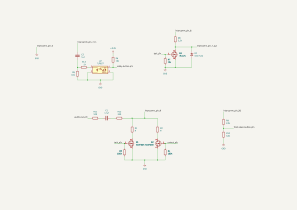
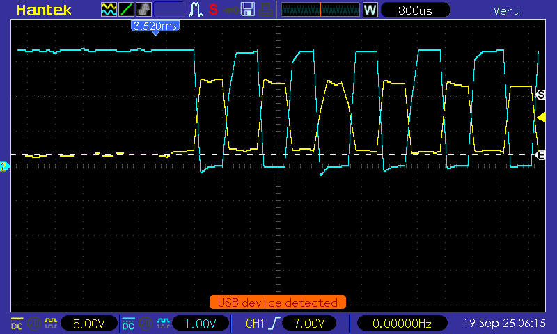
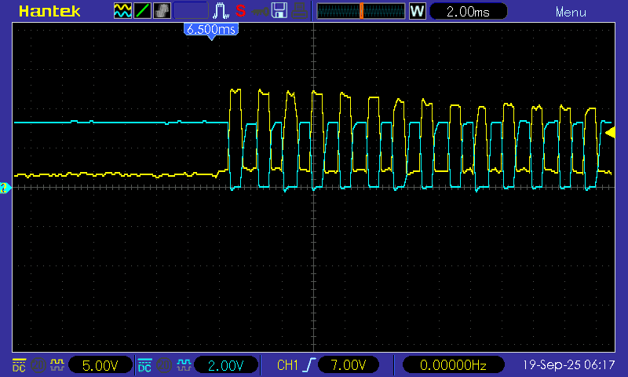
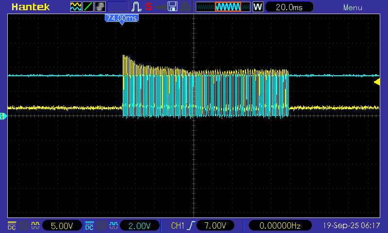
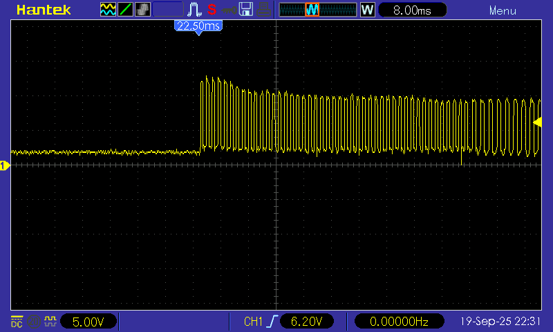
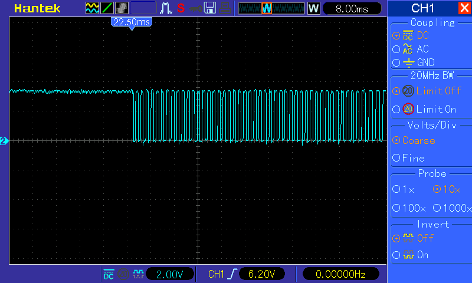

# Hardware

What's known about the intercom, how Dumbledoor connects to it, and what still needs checking. The circuit is the KiCad project in [`../dumbledoor/`](../dumbledoor/); the build photos and videos are on [lulalab.pt](https://lulalab.pt/#/projects/dumb-le-door) and [Hackaday](https://hackaday.io/project/203886-dumbledoor).

## The intercom

- **Monitor:** BPT System 200 video monitor with handset (Italian, from the 1990s).
- **Wall bracket:** BPT VKP/203 BB (part 62819300). The monitor plugs into it; the building's wires land on its screw terminals, numbered 3 to 20.
- **Lobby panel:** at the building's entrance, one call button per apartment. Each apartment has its own call wire.

### Terminals in use

From the labels on the wall next to the monitor:

| Terminal | Wire | Carries |
|---|---|---|
| 5 | black | GND, shared by every apartment |
| 6 | red | supply, about 12.5 V (measured; BPT's VA/200 power supply gives 17.5 V), shared by every apartment |
| 7 | green | call from the lobby panel. This apartment's own wire: the panel's button connects it to the power supply's call-tone generator while it's pressed. |
| 8 | purple | audio, lobby → apartment, shared |
| 9 | blue | audio, apartment → lobby, shared by every apartment. It also carries the monitors' commands as DC levels: the monitor's audio and door buttons work by loading this line. |
| 20 | yellow | call from the apartment's own doorbell, on the landing. In BPT's diagrams the landing button connects it to the power supply's second call-tone generator, so expect a tone like terminal 7's, not a DC level. |

### What BPT's manuals add

The building's wiring matches BPT's System 200 diagrams, where a "VM/200 + VKP/203" is one of the monitor options ([VA/200 power supply manual](https://doorentrydirect.com/media/product_attach_files/v/a/va200_01.pdf), diagram SE 8004.4; [YKP/200 monitor manual](https://www.ipcctv.ch/support/Files_DVD_ROM/BPT/Anleitungen/200/YKP200+YV_V00_09-04.pdf)):

- Every monitor's terminals 5, 6, 8 and 9 connect to the same lines in the riser. Whatever Dumbledoor puts on 6 or 9 reaches the whole building. Terminal 7 is this apartment's alone.
- The power supply has two call-tone generators ("two-tone note"). The first feeds the common of all the panel's call buttons; the second feeds the landing buttons (terminal 20). Each generator drives at most 3 monitors at once, and BPT's BC/200 call booster draws up to 1.2 A to ring 7 ([manual](https://doorentrydirect.com/media/product_attach_files/b/c/bc-200_installation_manual.pdf)). So a monitor's call input is a heavy load, probably tens of mA. Not measured yet.
- A call from the panel starts the power supply's 30 s activation timer (camera and audio), extended to 90 s at most when a handset is picked up.
- The power supply limits the door lock to 1–15 s (a trimmer), even while a monitor's door button is held. That's from the 2007 VA/200 manual; this building's power supply may be older.
- System 200 runs on DC, and BPT calls lines 8 and 9 "audio and commands".

## How Dumbledoor connects

```
                     terminal 7 is cut here
 lobby panel ──7_in──►┐                        ┌──7_out──► monitor (rings)
                      │      Dumbledoor        │
                      ├─ TLP627 ─► lobby_button_pin    bell_pin ─► Q3 ─┤
                      │                        │
 terminal 9  ◄────────┼─ R2 ◄─ Q2 ◄─ unlock_pin  (door)                 │
             ◄────────┼─ R1 ◄─ Q1 ◄─ talk_pin    (audio channel)        │
             ◄────────┼─ R12/C1/R11 ◄─ audio_out_pin (DAC, not used yet)│
 terminal 20 ─────────┼─ R9/R10 ─► front_door_button_pin                │
 terminal 6 (12.5 V) ─┼────────────────────────── R8 ──────────────────┘
 terminal 5 (GND) ────┴─ common ground
```

In the schematic, the lobby call line (terminal 7) runs **through** Dumbledoor: the panel's side comes in as `intercomm_pin_7_in`, and Dumbledoor drives the monitor's side, `intercomm_pin_7_out`. The firmware copies the call tone to the monitor edge by edge, so the monitor rings as it always did, and the call can also be muted. The other lines are tapped in parallel.

### The board today (October 2026)

Only part of the schematic is connected:

- **Lobby call input** on GPIO1, read through the ADC.
- **Door release** on GPIO13.
- **Four debug LEDs** on GPIO39, 37 and 35 (green) and GPIO33 (red).

`bell_pin`, `talk_pin`, `audio_out_pin` and the front-door input aren't connected yet. With no `bell_pin`, terminal 7 still runs straight from the panel to the monitor, and Dumbledoor only listens to it: the monitor rings on its own, and the app can't mute it.

## The circuit



The net labels (`lobby_button_pin`, `bell_pin`, …) are what the firmware's menuconfig options refer to.

1. **Lobby call in.** `7_in` → C2 (1 µF, AC coupling) → R13 (1 kΩ) → the LED of U2, a TLP627 Darlington optocoupler. R5 (10 kΩ) gives C2 a path to GND. The TLP627's collector is `lobby_button_pin`, pulled up to 3.3 V by R6 (10 kΩ). The pin is high when idle and goes low on every high half-cycle of the tone, so it toggles for as long as the button is held.
2. **Monitor call out.** R8 (2.2 kΩ) pulls `7_out` up to terminal 6 (12.5 V), and D2 (1N4742A, 12 V Zener) clamps it. Q3 (IRLZ24) pulls it to GND while `bell_pin` is high. R7 (10 kΩ) keeps Q3 off until the ESP32 drives the pin. So `bell_pin` high means the line is at 0 V, its idle level, and `bell_pin` low means the line is at ~12 V. **Don't build it this way:** it can't drive the monitor, and it holds the line at 12 V while the board is off. See [Ringing the monitor from the board](#ringing-the-monitor-from-the-board-proposed).
3. **Door and audio-channel "buttons".** Q2 (AO3400A, gate `unlock_pin`) pulls terminal 9 to GND through R2; Q1 (AO3400A, gate `talk_pin`) through R1. These do what the monitor's two buttons do. **R1 and R2 have no values in the schematic yet**: they're the values found with the trimmer pot. R3 and R4 (100 kΩ) keep both MOSFETs off while the ESP32 boots.
4. **Audio into the panel.** `audio_out_pin` → R11 (100 Ω) → C1 (47 µF) → R12 (330 Ω) → terminal 9. It's meant for the ESP32-S2's DAC (GPIO17 or GPIO18). The firmware doesn't use it yet. **Don't build it this way:** line 9 is shared by the whole building. See [Audio into the lobby panel](#audio-into-the-lobby-panel-not-built).
5. **Front door call in.** Terminal 20 → R9 (2.2 kΩ) / R10 (3.3 kΩ) divider → `front_door_button_pin`. That's 0.6 × the line's voltage, high while the doorbell is pressed. Terminal 20 probably carries a tone instead, which the divider can't take (see "Worth checking" 3).

Everything shares the intercom's ground (terminal 5): the TLP627 shifts the call's levels but doesn't isolate the grounds.

To update the image after editing the schematic:

```sh
kicad-cli sch export svg --exclude-drawing-sheet -o docs/images dumbledoor/dumbledoor.kicad_sch
mv docs/images/dumbledoor.svg docs/images/schematic.svg
```

## Signals

Scope captures from 19 Sep 2025. Hantek DSO5102P, 40 px per division; the frequencies were measured from the pixels. Which probe was on which line is my reading of the captures; correct it if it's wrong.

| Capture | What it shows |
|---|---|
|  | 800 µs/div. **Yellow** (5 V/div): the lobby call on terminal 7, a square wave from ~0 V to roughly 9–11 V. **Cyan** (1 V/div): the TLP627 output, 3.3 V idle, pulled to 0 V on every high half of the tone. |
|  | 2 ms/div: the start of a call. The tone's period is **~1.75 ms, about 570 Hz**. |
|  | 20 ms/div: a whole short press. The tone lasts **~170 ms**, so its length follows the button, which is what makes press codes possible. The first cycles are the strongest. |
|  | 8 ms/div, 5 V/div: a square wave from ~0 V to ~11–14 V. The tops sag over the first ~15 ms, as the panel's tone does in 119_2, so this is most likely the panel's tone too. It was first read here as a regenerated call on `7_out`, but R8 and D2 would give flat tops at ~12 V. |
|  | 8 ms/div, 2 V/div: a 3.3 V logic signal, idle high, toggling at the same rate. Most likely the TLP627 output. |

A video from 27 Aug 2025 measures a different line: a 6.10 kHz square wave, 0–8.2 V, with 76 µs pulses. It isn't the call (which is ~570 Hz), and which line it is isn't recorded.

In firmware terms, that means:

- The lobby input sees ~1,150 edges a second during a call. The firmware can read it two ways (`idf.py menuconfig` → Dumbledoor → "Read the lobby input"):
  - **Through the ADC** (the default, as the 18 Sep 2025 sketch did). 20,000 samples a second go through a software Schmitt trigger: below 1000 of 4095 is low, above 3000 is high, and every crossing counts as an edge. This tolerates a low level that isn't quite 0 V; a Darlington like the TLP627 can't pull all the way down (its saturation voltage is ~0.7–1 V). It only works on GPIO1–10 (ADC1). `idf.py monitor` logs the lowest and highest reading at rest and during every press, so the thresholds can be checked: the readings should cross both.
  - **As a digital pin**, with an interrupt on both edges. This is what `bell_pin` needs, because the interrupt also copies each edge to the monitor's line as it happens.
- Every 10 ms the door task checks whether any edges came in, which decides whether a press is in progress.
- A press starts after 20 ms of tone and ends after 120 ms without it (`DUMBLEDOOR_RING_RELEASE_MS`; the old sketches used 100 ms). The app's activity list shows every press's length, which is how to calibrate the code's short and long thresholds.

## Pins

The board as wired in October 2026. These are the firmware's defaults, and `firmware/sdkconfig.defaults` confirms them (`DUMBLEDOOR_PINS_SET`). Before rewiring, change them in `idf.py menuconfig` → Dumbledoor: while the confirmation is off, the firmware drives none of the outputs. The schematic doesn't include the ESP32 board yet, so this table is the record.

| Net | Direction | GPIO | menuconfig option |
|---|---|---|---|
| `lobby_button_pin` | in, active low, through the ADC | 1 | `DUMBLEDOOR_LOBBY_GPIO`, "Read the lobby input" |
| `unlock_pin` | out, active high | 13 | `DUMBLEDOOR_UNLOCK_GPIO` |
| debug LEDs | out, active high | 39, 37, 35 (green: 1st, 2nd, 3rd press), 33 (red) | `DUMBLEDOOR_PRESS_LED1..3_GPIO`, `DUMBLEDOOR_FAIL_LED_GPIO` |
| status LED | out | 15 (the S2 Mini's onboard LED) | `DUMBLEDOOR_LED_GPIO` |
| board button | in, to GND | 0 (BOOT on the S2 Mini) | `DUMBLEDOOR_BUTTON_GPIO` |
| `bell_pin` | out, high = line at rest | not connected | `DUMBLEDOOR_BELL_GPIO` (needs the lobby input read digitally) |
| `talk_pin` | out, active high | not connected | `DUMBLEDOOR_TALK_GPIO` |
| `front_door_button_pin` | in, active high | not connected | `DUMBLEDOOR_FRONT_GPIO` |
| `audio_out_pin` | DAC out | not connected (GPIO17 or 18 when it is) | — |

The old Arduino sketches ([`../legacy/arduino/`](../legacy/arduino/)) used the same lobby input, door and LEDs, apart from an earlier lobby input on GPIO12.

On the ESP32-S2, avoid GPIO 0, 45 and 46 for the intercom lines (strapping pins; 46 is input-only), 19 and 20 (USB, used for flashing and logs), and 26–32 on modules where they go to flash or PSRAM. GPIO1–14, 17, 18 and 33–38 have no internal pull-up at or after reset ([ESP32-S2 datasheet](https://documentation.espressif.com/esp32-s2_datasheet_en.pdf) v1.9, Table 2-1), so the 100 kΩ gate pull-downs keep the MOSFETs off while the board boots. GPIO39 (MTCK) gets a weak pull-up after reset, which only matters for an output that must stay off. The board is a LOLIN S2 Mini (4 MB flash, 2 MB PSRAM, native USB), which the old sketches were built for.

## Worth checking

1. **Once terminal 7 is cut, the monitor can't ring while Dumbledoor is off.** A dead board, a crash loop or a power cut would silence it. The firmware has watchdogs and keeps working without Wi-Fi, but the line needs a hardware fallback: the relay in [Ringing the monitor from the board](#ringing-the-monitor-from-the-board-proposed) reconnects the panel to the monitor whenever the board isn't driving it. Not an issue today, while terminal 7 isn't cut.
2. **The TLP627's LED reverse voltage.** With C2 in series, the LED sees the negative half of the AC-coupled tone. R5 (10 kΩ) is the only path for that half, against R13 (1 kΩ) for the other, so C2 shifts the waveform down: a simulation of the stage gives about −8 V across the LED for a 10 V tone, −10 V for 12 V and −12 V for 14 V. The TLP627's LED is rated for 5 V reverse. Until the 14 Sep 2025 revision the input was DC-coupled through a series diode (D1), which kept reverse voltage off the LED; the AC-coupled input from 25 Sep has nothing doing that. A 1N4148 across the LED (anti-parallel: its cathode on the LED's anode, pin 1) holds the reverse voltage at ~0.65 V, and raises the LED's current from ~1 mA to ~6 mA.
3. **The front-door divider's headroom.** 0.6 × the line means anything above ~5.5 V on terminal 20 puts more than 3.3 V on the GPIO (the S2's absolute maximum is 3.6 V). BPT's diagrams feed terminal 20 from the second call-tone generator, so a tone like terminal 7's (~10–14 V) is likely, which would put 6–8 V on the pin. Measure it before connecting anything, and plan a second TLP627 stage like the lobby's (with its 1N4148).
4. **`7_out` when the ESP32 isn't driving it.** With Q3 and R8, R7 holds Q3 off, so `7_out` sits at ~12 V DC while the ESP32 boots, and for as long as it's off or crashed. That's the line's active level, held indefinitely. The proposal below idles at 0 V instead.
5. **Power.** How the board is powered (USB, or terminal 6 through a regulator) isn't in the schematic yet. Anything connected to terminal 6 needs a fuse: it feeds every apartment, and a short there would trip the power supply's thermal cut-out for the whole building.
6. **Probing.** The scope's ground clip is connected to earth. Keep it on terminal 5: on any other terminal it shorts that line to earth.

## Ringing the monitor from the board (proposed)

To enter the code without the monitor ringing, the board has to own terminal 7 on the monitor's side and ring the monitor itself when the presses turn out to be a visitor's. Q3, R7, R8 and D2 can't do that:

- R8 (2.2 kΩ) gives the monitor at most 5.7 mA. The panel's generator drives a heavy load into it (see [What BPT's manuals add](#what-bpts-manuals-add)), so the monitor would ring weakly or not at all.
- While the board is off, booting or crashed, R8 holds the monitor's call input at ~12 V (see "Worth checking" 4).
- While idle, Q3 is on and R8 draws 5.7 mA from terminal 6 all the time.
- If the board dies with terminal 7 cut, the monitor goes silent.

The proposal: a relay that wires the panel straight to the monitor unless the board is driving it, and a push-pull driver.

```
 panel's wire (7_in) ──┬──────────────────► NC ─┐
                       │                        ├─ K1 COM ──► terminal 7 on the bracket (monitor)
                       │  driver ─ 33 Ω ──► NO ─┘
                       │    ▲
                       │  bell_pin (tone from LEDC)
                       └──► C2 / R13 / TLP627 ──► lobby_button_pin (always listening)
```

- **K1:** a small DPDT signal relay with a 5 V coil, not latching (e.g. Panasonic TQ2-5V, ~28 mA). Its coil is driven from a free GPIO by an AO3400A, with a 1N4148 across the coil and 100 kΩ from gate to GND. Not energized (board off, booting, crashed or unplugged) means the monitor is wired straight to the panel, as it always was. The firmware energizes it only while it's in control, and switches it only between calls. Move wires at the bracket's screw terminals, so the building's wire is never cut.
- **Driver:** a TC4427A (a push-pull MOSFET driver, 4.5–18 V, 3.3 V logic input), powered from terminal 6 through a ~200 mA resettable fuse and a 1N5819, with 100 µF and 100 nF at its supply pins. `bell_pin` goes to its input through 1 kΩ, with 10 kΩ to GND, so it idles low. Its output goes through 33 Ω to K1's NO contact. `bell_pin` high now means the line is high (no inversion), and the ESP32's LEDC peripheral makes the tone, so the lobby input can stay on the ADC.
- **K1's second pole** can switch a dummy load onto the panel's wire while the monitor is disconnected, if measurement 3 below shows that the power supply needs to see the monitor's load.
- **Firmware** (not written yet): the relay, the LEDC tone at the panel's frequencies, silent code entry (below), and the door task on the task watchdog with a reset on timeout, so a hung task drops the relay.

Measure first, with the scope's ground on terminal 5:

1. **The monitor's call current.** Put 10 Ω in series with the monitor's terminal 7, a probe on each end, and display CH1 − CH2 (10 mV = 1 mA) during a call. This sets the driver's series resistor and the dummy load.
2. **The tone over a long press** (~3 s, at 100–200 ms/div). One frequency, or two alternating? BPT calls it a two-tone note.
3. **The panel with the monitor disconnected.** Take the panel's wire off the bracket's terminal 7 and leave it on the board only. Have someone press the button at the panel. Does the tone still come, for as long as the press, and do the panel and camera behave as usual? If not, the power supply needs the monitor's load to see the call, and K1's second pole must put a dummy load there.
4. **The driver,** first into a resistor equal to the monitor's load, then into the monitor. The monitor should ring as before and turn its screen on. Then pick up the handset: the audio and the door button should work.

### Silent code entry

With K1 energized, the board decides when the monitor rings. It holds each press back while the presses so far could still be the start of the code. As soon as they can't (a press of the wrong kind, an unclear one, or one longer than any code press), the monitor rings: live if the button is still held, or a replay of the presses so far if not. If the presses stop before the code is complete, they're replayed after the 1.5 s gap. A right code never rings. A visitor's ring can arrive up to ~1.5 s late, but it's never lost.

## Audio into the lobby panel (not built)

R11, C1 and R12 connect the DAC to line 9, which every apartment shares. As drawn:

- While the DAC drives the pin (playing, or held at mid-scale), line 9 sees ~430 Ω plus the DAC's own output resistance to GND at audio frequencies. Every apartment's voice to the lobby passes along line 9, so this would weaken it.
- While the ESP32 is off, the pin's protection diodes clip line 9's audio at about ±0.5 V, through the same 430 Ω.
- Line 9 carries the commands as DC levels. Every change (any apartment's door button, a handset picked up) pushes a current pulse through C1 (47 µF, τ ≈ 20 ms) into the GPIO. A 6 V step gives ~14 mA through the pin's protection diode, and loads the line for those milliseconds while the power supply reads the command. Turning the DAC on (0 → 1.65 V) sends a similar pulse into the line.
- C1 is presumably an electrolytic. Which way round it goes depends on line 9's DC level, which isn't measured yet, and which falls when a button loads the line.
- A handset microphone's level is probably far below the DAC's 3.3 V p-p, and turning an 8-bit DAC down costs resolution.

It's in [Later](../PLAN.md#later), and the lock's buzz already tells the visitor that the code worked. If it's wanted:

1. Measure line 9: the DC level at rest, during a call with the handset picked up, and with the door button pressed; and the size of your voice on it while you talk into the handset.
2. Build it so line 9 sees nothing while it isn't playing:

```
 audio_out_pin ─ 1 kΩ ─┬─ 10 µF ─┬─ photoMOS (form A) ─┬─ 1 µF film ─ Rs ──► terminal 9
                     10 nF     100 kΩ                100 kΩ
                       │         │                     │
                      GND       GND                   GND
```

- The photoMOS (e.g. TLP222A, AQY212 or CPC1017N, its LED on a GPIO through 1 kΩ) is open while nothing plays, and while the ESP32 is off. Line 9 then sees ~100 kΩ through a capacitor: no DC load, no clipping, no pulses into the GPIO.
- It closes only while Q1 holds the audio channel open and a sound plays. Keep the DAC at mid-scale from boot, so nothing steps when it closes.
- Choose Rs (start at 4.7–10 kΩ) and the DAC's amplitude from the measurement.
